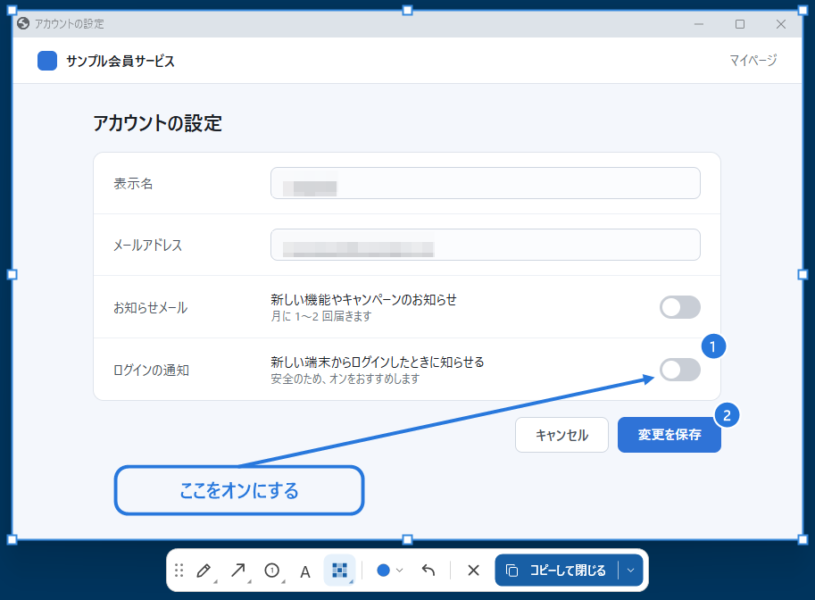
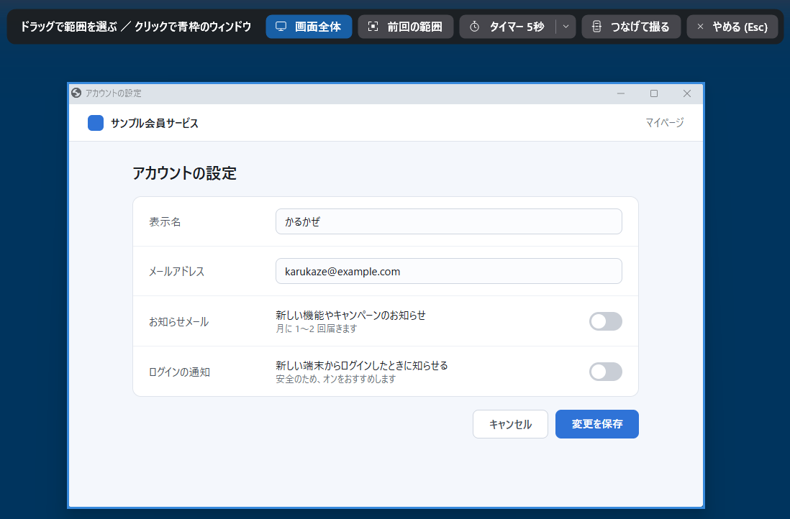
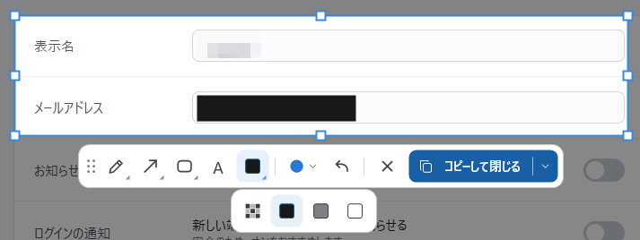

# ShotCopy

画面を撮って、その場で書き込んで、すぐ貼り付ける。チャットやメールに貼るまでを最短にする、小さなスクリーンショットツールです。

- インストールして使う版と、`ShotCopy.exe` を置くだけで使える版があります（どちらも機能は同じ）
- 撮った画像をインターネットに送ることはありません
- ふだん使う部分はシンプルに。こだわりたいときだけ、選んだものに合わせた機能が出てきます



## ダウンロード

[Releases](https://github.com/karukaze/ShotCopy/releases) の最新版から、どちらかをダウンロードしてください。

- **`ShotCopy-Setup.exe`（インストール版・おすすめ）**：起動して「インストール」を押すだけです。あなたのアカウントに入るので、管理者の権限はいりません。スタートメニューに「ShotCopy」が入り、Windows の「設定」→「アプリ」から削除できます
- **`ShotCopy.exe`（置くだけで使える版）**：好きな場所に置いて起動します。USB メモリなどに入れて持ち歩くこともできます

## 動作環境

- Windows 11
- .NET Framework 4.x（Windows に最初から入っているため、追加のインストールは不要）

S モードの Windows では動きません。

---

# 基本の使い方

1. `ShotCopy.exe` を起動すると、タスクトレイ（画面右下）に常駐します（アイコンを常に表示する方法は[下](#トレイにアイコンを常に表示するには)）
2. `Ctrl+PrintScreen` を押すか、トレイのアイコンをクリックすると、スクリーンショットを撮れます
3. 撮る範囲を選びます
   - ドラッグ：自由な範囲
   - クリック：青い枠で表示されたウィンドウ（前に別の窓が重なっていても、そのウィンドウだけが写ります）
   - 「画面全体」ボタン（または `Enter`）：マウスがある画面の全体
   - やめるときは、上の「× やめる」ボタン（または `Esc`）
4. 書き込みメニューから道具を選んで書き込みます
5. 「コピーして閉じる」（または `Enter`）を押します。撮る前の画面に戻るので、そのまま `Ctrl+V` で貼り付けられます。ボタンの右の ▾ か右クリックで、「コピーして、保存もする」「コピーして、名前を付けて保存...」も選べます



範囲の外をクリックしたときや右クリックしたときは、クリックした所の近くに、コピー・保存のしかたの一覧が出ます（うっかり押しても、書き込みは消えません）。やめるときは、メニューの × か `Esc` を押します。

## 書き込む道具

| 道具 | できること |
|---|---|
| ペン・蛍光ペン（`P`） | 自由に線を引く。ボタンを押すとペンと蛍光ペンを選べます |
| 矢印（`A`） | 矢印・直線・両矢印 |
| 図形（`S`） | 角丸・四角・丸・吹き出し・番号スタンプ（1, 2, 3…／A, B, C…） |
| 文字（`T`） | クリックした場所に文字を書く。`Enter` で確定、`Shift+Enter` で改行 |
| モザイク（`M`） | ドラッグした範囲をぼかして隠す。パスワードなど確実に隠したいときは、種類を「塗りつぶし」（黒・グレー・白）にすると塗って隠せます。白は白い背景の資料で目立たずに消せます（もう一度 `M` でも切り替え） |
| 色ボタン | 色（6色）と、線の太さ・文字の大きさ（3段階）。選んだ色と太さは次回も使われます |



- 書いたものをクリックすると選べます。選ぶと小さなメニューが出て、色・塗り・文字の修正・削除などができます。周りの白い丸をドラッグすると大きさが変わります
- `Ctrl+Z` で元に戻せます
- 書き込みメニューは、左端の点のマークをつかんで好きな場所へ動かせます
- ボタンや一覧は絵だけです。マウスを乗せると名前が出ます

書き込みメニューの色のボタンは、丸の色がいまの色、丸の大きさがいまの太さ（細・中・太）です。選んだ色と太さは、次に撮るときもそのまま使われます。

## 保存する

書き込みメニューの「コピーして閉じる」の右の ▾ から「コピーして、保存もする」（`Ctrl+S`）を選ぶか、コピー後に右下に出る案内の「保存」を押すと、画像をファイルにも保存できます（標準の保存先は `ピクチャ\ShotCopy`）。保存する場所や名前を決めたいときは、▾ の「コピーして、名前を付けて保存...」を選びます。案内を閉じてしまっても、トレイのメニューの「最後の画像を保存」から保存できます。

## ショートカット

スクリーンショットを撮るショートカットは、最初から **`Ctrl+PrintScreen`** です。範囲を選ぶ画面の中で、ドラッグで範囲、クリックでウィンドウ、上のボタンで画面全体やタイマーを選べるので、ふだんはこの1つだけで足ります。Windows の設定を変える必要はありません。

- `PrintScreen` を単独で押すと、これまでどおり Windows の切り取りツールが開きます（Windows が先に受け取るため、ShotCopy では単独の PrintScreen は使えません）
- 設定画面の「ショートカット」の一覧から、`Ctrl+PrintScreen`（おすすめ）・`Shift+PrintScreen`・ほかのキー・なし を選べます。「ほかのキーにする...」を選ぶと入力欄が出るので、使いたい組み合わせを押します（Ctrl・Alt・Shift のうち2つ以上。`Ctrl+V` のようによく使う組み合わせは登録できません）
- **押しても動かないとき**（ノートパソコンに多い）：`Fn` キーを押したまま、`Ctrl+PrtSc` を押してください
- **PrtSc キーが見つからないとき**（パソコンによって「PrtScn」「Prt Sc」「Print Screen」など表示が違います）：設定画面の「ショートカット」で「ほかのキーにする...」を選び、`Ctrl+Alt+S` などを押して登録してください
- ほかのスクリーンショットアプリ（ShareX、Greenshot など）が同じ組み合わせを使っていて登録できないときは、起動時に知らせて、起動中のアプリから候補を表示します。そのアプリの設定で外すか、別の組み合わせにしてください
- 画面全体・いま使っているウィンドウ・タイマーを、それぞれ別のキーで直接撮りたいときは、設定画面の「詳しい設定」で登録できます

ShotCopy は、キー入力を監視する仕組み（キーボードフック）を使いません。登録したショートカットの通知だけを受け取ります。例外として、タイマーの数字が出ている数秒の間だけ、「`Ctrl` だけが押されたか」を確かめます（すぐ撮るため。ほかのキーは、一緒に押されていないかを見るだけで、何のキーかは記録しません）。

---

# もっと使いこなす

知らなくても使えます。必要になったときに読んでください。

## まっすぐ・正方形にする（Shift）

- 図形：`Shift` を押しながらドラッグすると正方形・正円
- 矢印・ペン・蛍光ペン：`Shift` を押している間は、水平・垂直・45度にそろったまっすぐな線（ペンは離すと手描きに戻ります）
- 大きさを変えるとき：角を `Shift` でドラッグすると縦横の比率を保つ

描いている間は、マウスの近くに `Shift` の使い方が出ます（画像には写りません）。ペンで描いた線は、手ぶれを抑えて少しなめらかになります。

## 矢印・番号スタンプを図形にくっつける

- 矢印の端や番号スタンプを、四角・角丸・丸の四隅や辺のまん中に近づけると、吸い寄せられてくっつきます（くっつく点が青い点で表示されます）
- くっついたものは、図形を動かしたり大きさを変えたりしても、つながったままついてきます
- くっつけたくないときは `Alt` を押しながらドラッグします
- 矢印そのものを動かすか、端やスタンプを図形から離すと、くっつきは外れます
- 塗った図形の下に隠れている点にはくっつきません

## 図形・吹き出しの中に文字を書く

- **吹き出し**：描くとすぐ中に文字を入力できます。大きさは文字にぴったり合わせて調整されます。しっぽの先の白い丸をドラッグすると、向きを変えられます
- **角丸・四角・丸**：選んで文字を打ち始めるか、`Enter` かダブルクリックで中に文字を書けます。囲んだ範囲を変えないよう、文字が入りきらないときだけ広がります
- **文字に合わせる**：文字の入った図形を選んだときのメニューで、図形を文字にぴったりの大きさにできます
- **囲む**：書いた文字を選んだときのメニューで、選んだ形（角丸・四角・丸・吹き出し）で文字を囲めます
- 図形を選んで色ボタンを押すと、色・線の太さ・文字の大きさを別々に変えられます。塗りを濃い色にすると、中の文字は自動で白になります

## 番号スタンプ

- クリックするたびに 1, 2, 3…（記号なら A, B, C…）と番号が増えます。手順の説明に便利です
- 途中の番号を消すと、後ろの番号が自動でつまります（1・2・3・4 から 2 を消すと 1・2・3）
- スタンプを選んで数字を打つ（または `Enter`、ダブルクリック）と番号を変えられます。その位置に割り込み、ほかの番号は自動でふり直されます
- スタンプを選んで `↑`（または小さなメニューの「+1」）で番号が 1 つ増え、`↓`（「−1」）で 1 つ減ります
- 最初の番号は、色・大きさの一覧の「最初の番号」の − ＋ で変えられます（5 にすると 5, 6, 7…）
- 数字と記号は別々に数えます

## タイマーで撮る（クリックすると消えるメニューを撮るとき）

右クリックメニューやサブメニューは、**開いたまま `Ctrl+PrintScreen` を押すだけで撮れる**ことがほとんどです（ShotCopy は押した瞬間に画面を止めるため）。キーを押すと閉じてしまうもの（マウスを乗せている間だけ出る説明など）や、うまく撮れなかったときは、タイマーを使ってください。

1. 次のどれかで始めます
   - トレイのアイコンを右クリック →「タイマーで撮る」→ 秒数（3・5・10秒）を選ぶ
   - 範囲を選ぶ画面の上の「タイマー ○秒」ボタン（右の ▾ で秒数を選べます）
   - 設定したショートカット
2. 右下に残りの秒数が出ている間に、撮りたいメニューを開きます（この表示は画像には写りません）。準備ができたら、`Ctrl` を1回押すと時間を待たずにすぐ撮れます
3. 時間になると画面が止まり、上に「タイマーで撮りました」と出るので、いつもどおり範囲を選んで書き込みます

やめるときは、右下の表示の「× やめる」か `Esc` を押します（トレイのアイコンのクリックでもやめられます）。タイマーで撮ったときは、マウスの矢印も画像に写ります（設定でオフにできます）。

## つなげて撮る（長いページを1枚に）

スクロールしないと全部見えない長いページや設定画面を、縦に長い1枚の画像にします。

1. 次のどちらかで始めます
   - 範囲を選ぶ画面の上の「つなげて撮る」ボタン
   - トレイのアイコンを右クリック →「つなげて撮る（スクロール）」
2. スクロールする部分（ページの本文など）をドラッグで選びます（クリックならそのウィンドウ）
3. 選んだ部分のまわりに青い枠が出ます。マウスのホイールなどで、自分でゆっくりスクロールします（上へも下へも、つないでいきます）
4. 撮り終わったら「ここまで」か `Enter` を押します
5. つないだ画像を確かめる画面が出ます。ホイールで全体を見て、「コピーして閉じる」「コピーして、保存もする」「やめる」から選びます
6. 矢印や番号を足したいときは、左下の「書き込む」を押します。いつもの書き込みの画面で開き、ホイール（または `PageUp`・`PageDown`）で画像を上下に動かしながら書き込めます。書き込みをやめると、確かめる画面に戻ります

- スクロールは自分でします。ShotCopy がほかのアプリを勝手に動かすことはありません
- ページの途中から始めて、上へ行ってから下へ、という撮り方もできます
- 撮っている間の小さなパネル（案内と「ここまで」「やめる」）は画像には写りません。じゃまなときはドラッグで動かせます
- 速くスクロールしすぎて「つなげません」と出たら、少し戻してください。続きからつなぎます
- 上や下に止まったままの帯（ページの見出しの帯など）は、1回だけ写ります
- GIF アニメなど、範囲の中で動くものがあっても、たいていはつなげます。画面の大部分が動画のときは、うまくいかないことがあります
- やめるときは「やめる」か `Esc` を押します

## ウィンドウだけを撮る

ウィンドウをクリックして撮るときと「いま使っているウィンドウを撮る」のときは、そのウィンドウだけの中身を取り込むので、前に重なっている窓は写りません。ゲームや動画など、この取り込みに対応していない窓のときは、画面の見た目どおりに撮ります。

## 撮り直さずに直す・同じ範囲で撮る

- **書き直す**：コピーしたあとの案内の「書き直す」か、トレイのメニューの「最後の画像を書き直す」で、最後の画像を、書き込みを直せる状態のまま開き直せます
- **前回と同じ範囲で撮る**：範囲を選ぶ画面の上の「前回の範囲」ボタン、トレイのメニュー、または設定したショートカット（設定の「詳しい設定」→「前回と同じ範囲で撮る」）で、最後にコピーした範囲をそのまま撮って、書き込みから始められます

どちらも ShotCopy を終了するまで覚えています。

## 書き込み中のキー操作

| キー | 動作 |
|---|---|
| `P` / `A` / `S` / `T` / `M` | 道具の切り替え（数字の `1`〜`5` でも可）。同じキーをもう一度押すと種類が切り替わります。`H` で蛍光ペン |
| `Shift` + ドラッグ | 正方形・正円 ／ まっすぐな線 ／ 比率を保つ |
| `Alt` + ドラッグ | 図形にくっつけずに自由な位置に置く |
| `Enter` | 範囲選択中：画面全体を選ぶ ／ 書き込み中：コピーして閉じる（文字・図形・スタンプを選んでいるときは、その文字や番号を直す） |
| `T` ／ `L` ／ `S` | 範囲選択中：タイマーで撮る ／ 前回の範囲 ／ つなげて撮る（上の帯のボタンと同じ） |
| 右クリック | 書き込み中：クリックした所の近くに、コピー・保存のしかたの一覧を出す（範囲の外のクリックも同じ） ／ 範囲選択中：やめる |
| `Ctrl+C` | コピーして閉じる |
| `Ctrl+S` | コピーして、ファイルにも保存 |
| `Ctrl+Z` | 元に戻す |
| `Delete` | 選んでいるものを削除 |
| `↑` / `↓` | 選んでいる番号スタンプの番号を増やす／減らす |
| `Esc` | 一覧を閉じる → 選択を外す → やめる |

文字の入力中に書き込みメニューの道具を押すと、文字を確定してすぐその道具に切り替わります。文字を `Enter` で確定した直後の `Enter` では閉じず、「もう一度 Enter でコピーして閉じます」と案内が出ます。

## 設定

トレイのアイコンを右クリック →「設定...」で、次のことができます。

- **スクリーンショットを撮る**：ショートカット（標準は `Ctrl+PrintScreen`）
- **起動**：パソコンを起動したら、ShotCopy も自動で起動するかどうか（オフにしたときは、使うときにスタートメニューから起動します）
- **画像の保存**：保存先（「標準に戻す」で元に戻せます）と、コピーと同時に保存するかどうか
- **詳しい設定**（押すと開きます）：撮り方ごとのショートカット（画面全体・いま使っているウィンドウ・タイマー）、コピーしたあとの案内を出す時間、タイマーの秒数とマウスの矢印も写すかどうか

設定画面の一番下の「使い方」から、このページと同じ内容をネットにつながっていなくても見られます。

## トレイにアイコンを常に表示するには

1. 画面右下、タスクバーの「^」をクリックします
2. 出てきた ShotCopy のアイコンを、タスクバーの上へドラッグします

---

## 初めて起動するときの注意

ShotCopy にはデジタル署名がないため、インターネットから入手した場合、初回に「Windows によって PC が保護されました」と表示されることがあります。「詳細情報」→「実行」で起動できます。

職場などのパソコンでは、管理の設定によって実行できない場合があります。その場合は、パソコンの管理をしている人に確認してください。

## ソースからビルドする

Visual Studio などは不要です。Windows に付属しているコンパイラでビルドできます。

```powershell
.\build.ps1
```

同じフォルダに `ShotCopy.exe` ができます（使い方のページ `help.html` も exe の中に入ります）。アイコン（`ShotCopy.ico`）は `make-icon.ps1` で作り直せます。

インストーラー（`ShotCopy-Setup.exe`）は、次で作れます（`ShotCopy.exe` を作ってから、インストーラーの中に入れます。ソースは `installer\Setup.cs`）。

```powershell
.\build-installer.ps1
```

ソースは役割ごとに `src` フォルダに分けています。

| ファイル | 中身 |
|---|---|
| `Program.cs` | 起動・想定外のエラーの知らせ |
| `Tray.cs` | タスクトレイのアイコンとメニュー、ショートカットの受け取り |
| `ShotFlow.cs` | 撮影の流れ（撮る → 書き込む → コピー・保存 → 案内） |
| `CaptureOverlay.cs` | 範囲を選ぶ画面と、書き込みの画面 |
| `Shapes.cs` | 書き込みの図形（ペン・矢印・図形・スタンプ・文字・モザイク） |
| `ScrollCapture.cs` | つなげて撮る と、その確認画面 |
| `SmallForms.cs` | タイマーの残り秒数、コピー後の案内 |
| `SettingsForm.cs` / `Settings.cs` | 設定画面 ／ 設定の保存・読み込み |
| `Icons.cs` / `Native.cs` | アイコン ／ Windows の機能の呼び出しと見た目の共通部品 |

## プライバシー

- 撮った画像や書き込みを外部に送信することはありません。新しい版の自動確認もしません
- 保存されるのは、設定（`%APPDATA%\ShotCopy\settings.txt`）、使い方のページ（同じフォルダの `help.html`）、想定外のエラーが起きたときの記録（同じフォルダの `error.log`）、保存した画像（設定した保存先）だけです
- 自動起動をオンにした場合のみ、Windows のスタートアップ登録（レジストリの `HKCU\...\Run`）を使います

## 使うのをやめるとき

**インストール版**：Windows の「設定」→「アプリ」→「インストールされているアプリ」で「ShotCopy」の「…」→「アンインストール」を押します。ShotCopy・スタートメニューなどのアイコン・自動起動・設定のフォルダが削除されます（保存した画像 `ピクチャ\ShotCopy` は残ります）。

**置くだけで使える版**：

1. 自動起動をオンにしている場合は、設定画面でオフにします
2. トレイのアイコンを右クリック →「終了」
3. `ShotCopy.exe` と `%APPDATA%\ShotCopy` フォルダを削除します（保存した画像が不要なら `ピクチャ\ShotCopy` も）

設定のフォルダ（`%APPDATA%\ShotCopy`）は、エクスプローラーの上のアドレス欄に `%APPDATA%\ShotCopy` と入れて `Enter` を押すと開けます。このフォルダは、設定を保存したときや、色・太さを選んだとき、使い方のページを開いたときなどにだけ作られます（一度も作られていなければ、消すものはありません）。

## 不具合・要望

不具合や要望は [Issues](https://github.com/karukaze/ShotCopy/issues) からお知らせください。エラーのお知らせが出たときは、`%APPDATA%\ShotCopy\error.log` の内容を添えてもらえると原因を調べやすくなります。個人で作っているため、返事や対応にはお時間をいただくことがあります。

気に入ったら、このページ右上の ★（Star）を押してもらえると励みになります。

## ライセンス

[MIT License](LICENSE) © 2026 karukaze

無料で、個人でも仕事でも使えます。ソースを読んだり、改造して配ったりすることもできます（そのときは、著作権の表示とライセンスの文を残してください）。保証はありません。くわしくは [LICENSE](LICENSE) を見てください。
